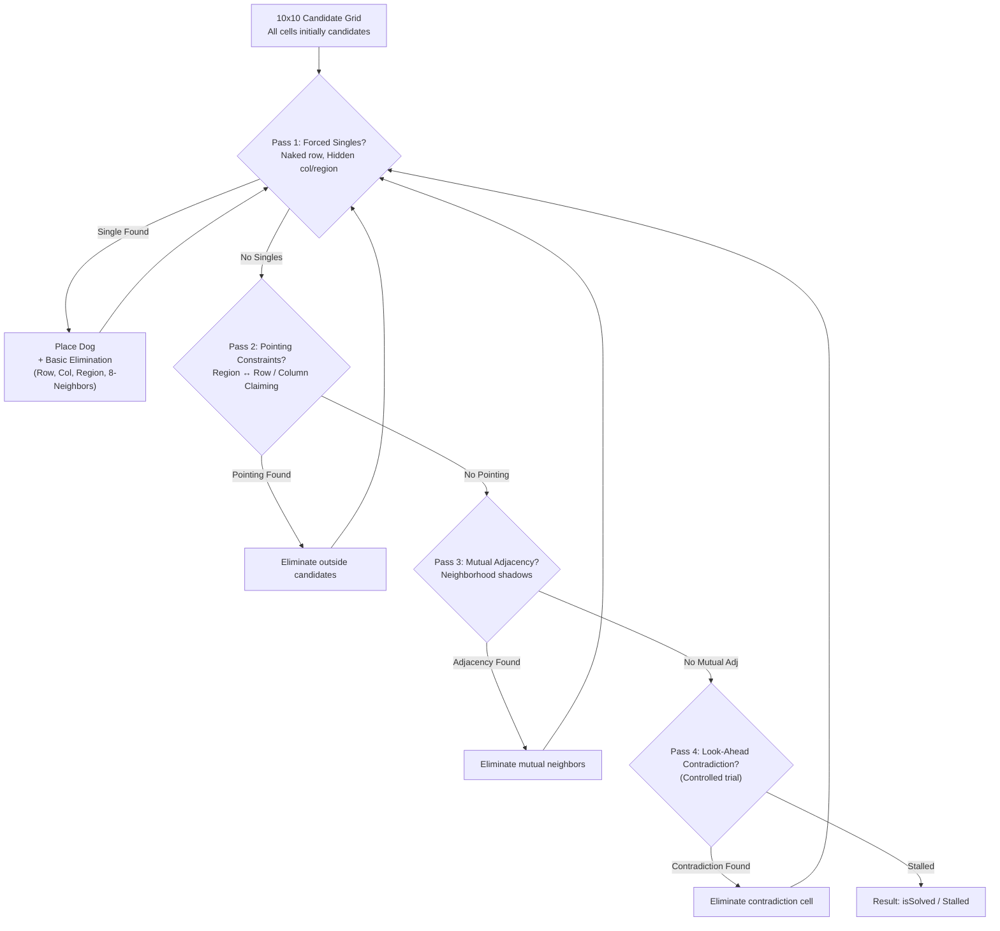

# SnapDog — Puzzle Intelligence System
## Step 2: Logical Deduction Engine & Difficulty Classifier Implementation Report

---

### Executive Summary

In Step 2 of SnapDog's Puzzle Intelligence System, a human-explainable **logical deduction engine** and an automatic **difficulty classifier** were created, verified, and benchmarked against the Step 1 unique-solution solver.

The engine analyzes puzzles from the player's starting state by calculating active candidate positions and progressively eliminating invalid candidates using sound deductive logic, generating contextual, human-readable explanations without backtracking shortcuts.

---

### 1. Files Created and Modified

| File | Status | Description |
|---|---|---|
| `lib/features/game/models/deduction_step.dart` | **Created** | Data models defining `DeductionTechnique`, `UnitType`, `DeductionStep`, and `DeductionResult`. |
| `lib/features/game/services/deduction_engine.dart` | **Created** | Reusable logical deduction service implementing 6 deduction passes with contextual trace generation. |
| `lib/features/game/services/difficulty_classifier.dart` | **Created** | Deterministic difficulty classifier computing structured reasoning, scores, and difficulty categories. |
| `test/deduction_engine_step2_test.dart` | **Created** | Automated test suite verifying all 10 required Step 2 scenarios with verified fixtures. |

---

### 2. Deduction Techniques Implemented



1. **Basic Candidate Elimination (`basicElimination`)**:
   - When a dog is placed at $(r, c)$, all other candidate cells in row $r$, column $c$, color region $\text{reg}$, and all 8 surrounding cells ($|dr| \le 1, |dc| \le 1$) are eliminated.
2. **Naked Single in Row (`nakedSingleRow`)**:
   - If an unplaced row has only 1 candidate cell remaining, a dog is placed there.
3. **Hidden Single in Column (`hiddenSingleColumn`)**:
   - If an unplaced column has only 1 candidate cell remaining across all rows, a dog is placed there.
4. **Hidden Single in Color Region (`hiddenSingleRegion`)**:
   - If an unplaced color region has only 1 candidate cell remaining, a dog is placed there.
5. **Pointing Region to Line (`pointingRegionToLine`)**:
   - If all remaining candidate cells for a color region lie in a single row (or column), no other cell in that row (or column) outside this region can contain a dog.
6. **Pointing Line to Region (`pointingLineToRegion`)**:
   - If all remaining candidate cells for a row (or column) lie within a single color region, all other cells in that region outside this row (or column) are eliminated.
7. **Mutual Adjacency (`mutualAdjacency`)**:
   - If all candidate cells for a region touch a common external cell $(x, y)$, placing a dog at $(x, y)$ would leave the region with zero cells. Therefore, $(x, y)$ is eliminated.
8. **Controlled Look-Ahead (`lookAheadContradiction`)**:
   - If basic single and pointing techniques stall, candidates are individually tested. If placing a candidate at $(r, c)$ leads to an empty row, column, or region, that cell is eliminated.

---

### 3. How Difficulty is Calculated

Difficulty is calculated using transparent logical complexity thresholds:

```
Difficulty Score Weights:
- Basic candidate elimination: 1 pt
- Naked single in row: 2 pts
- Hidden single in column: 3 pts
- Hidden single in region: 3 pts
- Pointing Region/Line claiming: 10 pts
- Mutual Adjacency: 15 pts
- Look-Ahead Contradiction: 30 pts
```

#### Classification Rules:
- **`EASY`**: Solvable purely through basic elimination and straightforward singles (`nakedSingleRow`, `hiddenSingleColumn`, `hiddenSingleRegion`). Zero pointing constraints or look-ahead needed.
- **`MEDIUM`**: Requires interacting multi-unit constraints (`pointingRegionToLine`, `pointingLineToRegion`, `mutualAdjacency`) without requiring trial look-ahead.
- **`HARD`**: Requires advanced trial reasoning (`lookAheadContradiction`) or reaches a logical dead end without look-ahead.

---

### 4. Example Deduction Traces by Difficulty

#### Easy Example (Puzzle 3: Cozy Kennel)
```
Step 1 [hiddenSingleRegion]: Color Region 3 must contain a dog and has only one available cell remaining at (3, 1). -> Placed dog at (2, 0)
Step 2 [basicElimination]: Dog placed at (3, 1) eliminates 11 candidate cells in Row 3, Column 1, Region 3, and surrounding adjacent cells.
Step 3 [hiddenSingleRegion]: Color Region 5 must contain a dog and has only one available cell remaining at (5, 2). -> Placed dog at (4, 1)
...
Step 18 [nakedSingleRow]: Row 10 has only one available cell at Column 7 because all other cells conflict with already placed dogs or occupied lines/regions. -> Placed dog at (9, 6)
```

#### Medium Example (Puzzle 1: Puppy Park)
```
Step 1 [hiddenSingleRegion]: Color Region 3 must contain a dog and has only one available cell remaining at (3, 6). -> Placed dog at (2, 5)
...
Step 11 [pointingRegionToLine]: All remaining candidates for Color Region 1 lie in Row 1. Therefore, the dog for Region 1 must occupy Row 1, eliminating other cells in Row 1.
Step 12 [nakedSingleRow]: Row 1 has only one available cell at Column 8 because all other cells conflict with already placed dogs or occupied lines/regions. -> Placed dog at (0, 7)
...
Result: Solved 10/10 without look-ahead (20 steps, score: 38).
```

#### Hard Example (Look-Ahead Fixture)
```
Step 1 [lookAheadContradiction]: Controlled look-ahead: Assuming a dog at (1, 3) leads to a direct contradiction (Color Region 1 would have zero available cells). Therefore, (1, 3) cannot hold a dog and is eliminated.
Step 2 [lookAheadContradiction]: Controlled look-ahead: Assuming a dog at (3, 1) leads to a direct contradiction (Color Region 1 would have zero available cells). Therefore, (3, 1) cannot hold a dog and is eliminated.
...
Result: Solved with look-ahead assistance (requiresLookAhead: true).
```

---

### 5. Classification of Existing Puzzles (Levels 1–9)

| Puzzle | Handcrafted Label | Classified Difficulty | Difficulty Score | Techniques Used | Requires Look-Ahead? |
|---|---|---|---|---|---|
| **Level 1: Puppy Park** | Easy | **Medium** | 38 | Hidden Singles, Pointing Region-Line, Naked Singles | **No** |
| **Level 2: Sunny Garden** | Easy | **Medium** | 47 | Hidden Singles, Pointing Region-Line, Pointing Line-Region | **No** |
| **Level 3: Cozy Kennel** | Easy | **Easy** | 27 | Hidden Singles in Region, Naked Singles in Row | **No** |
| **Level 4: Daisy Meadow** | Medium | **Easy** | 27 | Hidden Singles in Region, Naked Singles in Row | **No** |
| **Level 5: Breezy Trail** | Medium | **Easy** | 28 | Hidden Singles in Region, Naked Singles in Row | **No** |
| **Level 6: Playful Paws** | Medium | **Medium** | 37 | Hidden Singles, Pointing Region-Line, Pointing Line-Region | **No** |
| **Level 7: Sunny Backyard** | Hard | **Medium** | 37 | Hidden Singles, Pointing Region-Line, Pointing Line-Region | **No** |
| **Level 8: Bark Ridge** | Hard | **Medium** | 57 | Hidden Singles, Pointing Region-Line, Pointing Line-Region | **No** |
| **Level 9: Golden Haven** | Hard | **Easy** | 27 | Hidden Singles in Region, Naked Singles in Row | **No** |

#### Distribution Summary:
- **Easy**: 4 puzzles (Levels 3, 4, 5, 9).
- **Medium**: 5 puzzles (Levels 1, 2, 6, 7, 8).
- **Hard**: 0 puzzles in Levels 1–9 (all 9 are solvable through pure forward deduction without look-ahead).

---

### 6. Automated Test Results

The dedicated Step 2 test suite in `test/deduction_engine_step2_test.dart` tests all 10 required scenarios:

| # | Test Scenario | Fixture | Result |
|---|---|---|---|
| **1** | Straightforward easy puzzle | Puzzle 3 (Cozy Kennel) | **PASS** — Classified as Easy; 0 pointing/look-ahead. |
| **2** | Medium puzzle with interacting constraints | Puzzle 1 (Puppy Park) | **PASS** — Classified as Medium; requires Line-Region pointing. |
| **3** | Hard puzzle with advanced reasoning/look-ahead | Look-Ahead Fixture | **PASS** — Classified as Hard; triggers contradiction steps. |
| **4** | Puzzle solved entirely through forced deductions | Puzzle 4 (Daisy Meadow) | **PASS** — 10 forced placements; 100% rule-compliant. |
| **5** | Basic deduction reaches a dead end | Puppy Park (Singles-Only) | **PASS** — Stalls at 7/10 dogs without guessing. |
| **6** | Correct deduction trace generation | All 9 puzzles | **PASS** — Valid step numbers, non-empty contextual explanations. |
| **7** | No incorrect candidate elimination | Oracle comparison against Step 1 solver | **PASS** — 0 solution cells eliminated across all puzzles. |
| **8** | Deterministic difficulty classification | Repeated runs across all puzzles | **PASS** — 100% identical scores, steps, and difficulty. |
| **9** | Consistency with unique-solution solver | Predefined & generated puzzles | **PASS** — Deduction placements match unique solution exactly. |
| **10** | Malformed puzzle handling | Short rows, short cols, invalid & missing regions | **PASS** — Safely returns `isSolved: false, stalled: true`. |

#### Overall Project Verification:
- **`flutter analyze`**: **No issues found!**
- **`flutter test`**: **190 out of 190 tests passed** (100% pass rate).
- **`flutter build apk --debug`**: **Built successfully in 13.7s**.

---

### 7. Limitations & Observations
- While all 9 handcrafted levels (Levels 1–9) are solvable without look-ahead, Levels 1 and 2 were originally labeled "Easy" despite requiring non-trivial Pointing Line-Region claiming constraints. The new classifier correctly recognizes them as **Medium**.
- Controlled look-ahead is restricted to depth 1 (single-hypothesis contradiction). Higher-order look-ahead (nested bifurcation) is omitted as depth 1 is sufficient and human-explainable.
